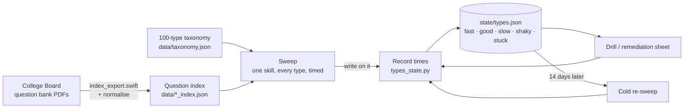

# SAT Study System

**Turns the College Board's free SAT question bank into timed study sheets you
can write on, and uses the times you write down to decide what you study next.**

By Franco Gómez Schumacher. Licensed under AGPL-3.0.

---

## Why

Most study plans tell you *what* to study and *when*. They don't say what to
actually do when you sit down. That gap is where the friction is: you open the
plan at 06:00, read "practise quadratics", and spend the first fifteen minutes
deciding which questions, how many, and in what order. Some days that decision
is enough to stop you studying at all.

This system fills that gap. Each study block gets one ready-made notebook with
the questions, the space to work, a box for your time, and the worked solution
overleaf. When you sit down there is nothing left to decide. You open the sheet
and start.

The second idea is that **on the SAT maths section the problem is usually
speed, not knowledge.** The real section gives you about 95 seconds per
question. That is plenty when the method comes to you straight away, and far
too little when it doesn't. So every question is timed, and the times decide
what gets studied. If a question type is slow, it gets a drill. If it is fast,
it gets left alone.

## How it works



1. **Index.** You export the eight question-bank PDFs yourself. A Swift/PDFKit
   indexer then records each question's ID, domain, skill, difficulty, answer
   and the exact line where the answer starts on the page.
2. **Sweep.** For one College Board skill, a sweep puts about 15 questions in
   front of you, spread across every *type* in that skill. Each question is on
   its own page with a time box, and the official solution is on the next page.
3. **Record.** You write down the seconds and tick what happened (*had it*,
   *slow to see it*, *slipped*, *no method*, and so on). `types_state.py`
   turns those results into a status for each type.
4. **Remediate and drill.** Types marked slow, shaky or stuck get a spaced
   retrieval drill picked from that state, or a hand-written remediation sheet
   aimed at the skill underneath them.
5. **Re-sweep.** Fourteen days after a type is marked remediated, it comes back
   as a cold re-sweep. That shows whether the fix actually held.

Sheets are produced as Supernote `.note` notebooks, so you write on them
directly on the device. You can also push them to the device and pull them
back automatically through Supernote Cloud.

Reading & Writing uses a simpler version of the same loop. Sets are filtered by
domain, skill and difficulty, and you can start each set with a rule card you
wrote yourself (`content/rw/`).

The full loop and a reference for every tool are in
**[docs/how-it-works.md](docs/how-it-works.md)**.

## What's in the box, and what you bring

| Included | You provide |
|---|---|
| All the tools: indexer, croppers, sheet builders, state tracker, Supernote push/pull | **The eight question-bank PDF exports** (free from College Board, see setup) |
| `data/taxonomy.json`: 19 College Board maths skills split into **100 question types** and **34 underlying skills**, each type with a one-line *cue* and *procedure* | Your own index, generated from your PDFs by the indexing run |
| `data/type_assignments.json`: 1,157 medium and hard maths questions mapped to a type | Your progress (`state/`, which starts empty) |
| Three sample authored sheets (`content/targets/R05…`, `R07…`, `content/rw/R03.md`) | Any further remediation sheets or rule cards you want ([docs/authoring.md](docs/authoring.md)) |
| | A Supernote, if you want automatic delivery (optional) |

## Quick start

You need macOS, Node 22 or later, Python 3, and a checkout of
[xiehanzi](https://github.com/franco-g-s/xiehanzi), which renders the sheets
and writes the `.note` files. The full walkthrough, with a "you should see…"
check after every step, is in **[docs/setup.md](docs/setup.md)**. In short:

```sh
git clone https://github.com/franco-g-s/xiehanzi ../xiehanzi
(cd ../xiehanzi && npm install && npm run build && npx playwright install chromium)
npm install

# export the eight PDFs into bank/, then index them (docs/setup.md, step 3)
python3 tools/types_state.py init
node tools/build_sweep.mjs "Circles" --dry      # preview a sweep
node tools/build_sweep.mjs "Circles"            # build out/SW-circles.note
```

## Repository layout

| Path | What |
|---|---|
| `tools/` | Every script. Node (`.mjs`) builds sheets, Swift (`.swift`) reads the PDFs, Python (`.py`) handles state and data checks |
| `data/taxonomy.json` | The 100 question types, their cues and procedures, and the underlying skills |
| `data/type_assignments.json` | Question ID → type, for medium and hard maths |
| `data/figures_overrides.json` | Hand labels for questions whose figure type the rules can't determine |
| `data/assign/out/` | Raw output of the tagging pass that produced `type_assignments.json` |
| `content/targets/` | Authored maths sheets (remediation, drills) in a small markdown dialect |
| `content/rw/` | Authored Reading & Writing rule cards |
| `bank/` | *You create this.* The College Board PDFs. Gitignored |
| `state/` | *Created as you go.* Your progress. Gitignored, see [state/README.md](state/README.md) |
| `out/` | Built sheets (`.note` and `.html`) and the crop cache. Gitignored |
| `docs/` | [Setup](docs/setup.md) · [How it works](docs/how-it-works.md) · [Authoring sheets](docs/authoring.md) · [Design notes](docs/design.md) |

## Design ideas

- **Timing is the diagnosis.** Every sweep question has a time box. Without a
  number, "slow" is just an impression and can't be checked. Status comes from
  what you recorded: median seconds against fixed limits (55 s fast, 110 s
  good), together with *why* a question went wrong.
- **Fail closed on crops.** A question page shows only what is above the
  "Correct Answer" line. If that line can't be found, the question is dropped
  rather than cropped at a guess. `verify_index.swift` then checks every row:
  the page holds the question it claims to, and the cropped area contains the
  question header but not the answer.
- **Coverage before depth.** A sweep rotates through every type in a skill
  before it repeats any of them. Each weak type gets one remediation sheet,
  then you move on. This keeps a single hard topic from taking all your hours.
- **Fix the underlying skill, not each type separately.** Types are linked to
  shared underlying skills ("factor a quadratic" appears inside six types).
  When several slow types share one, a single sheet can fix all of them.
- **Interleave.** Sweeps rotate across types. R&W sets alternate difficulties
  instead of getting harder towards the end. Drills spread out repeats of the
  same type.
- **R&W timing is optional.** R&W sets have a time box by default.
  `--untimed` removes it for sets where the habit being built is
  deliberately slower, like reading to the end of the sentence before
  choosing an answer.
- **Selection is deterministic.** The same command chooses the same questions
  in the same order. Every question a sheet uses is recorded, so no question
  appears on two sheets. Rebuilding a sheet keeps its own questions.
- **Builds refuse rather than quietly losing content.** If text would be
  clipped off a page, a hand-written answer fails its check, or the taxonomy
  check fails, the build stops instead of producing a sheet.

## College Board material

This project is **not affiliated with, endorsed by, or sponsored by College
Board.** SAT is a trademark registered by College Board. **This repository
contains no College Board questions, passages, answers or rationales.** It
contains software, plus a taxonomy and question-ID mapping written
independently by the author. You download the question-bank PDFs yourself
from College Board's free
[SAT Suite Question Bank](https://satsuite.collegeboard.org/k12-educators/tools-resources/question-bank/overview)
and use them under College Board's terms. Do not commit them, or the sheets
built from them, to a public repository.

## License

[AGPL-3.0](LICENSE) © 2026 Franco Gómez Schumacher. You may use, change and
share it. If you distribute a modified version, or run one as a network service,
you must publish your changes under the same license. Sheet rendering depends on
[xiehanzi](https://github.com/franco-g-s/xiehanzi), also AGPL-3.0.
